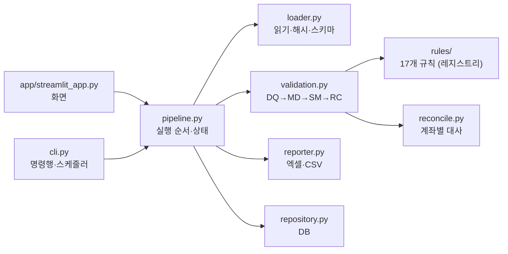

# 금융 데이터 검증·대사 자동화

하루치 계좌 거래내역을 받아 세 단계를 자동으로 수행하는 도구입니다. 결과는 엑셀 보고서, 정상·격리 거래 CSV, 실행 이력(DB)으로 남습니다.

- **품질 검증 (DQ-01~07):** 빈 값, 형식 오류, 중복을 찾습니다.
- **기준정보 정합성 (MD-01~05):** 계좌 마스터·거래코드 마스터와 거래내역을 대조합니다.
- **집계표 검증·대사 (SM-01, RC-01~04):** 계좌별 거래 합계를 집계표와 비교합니다.

설계와 규칙은 [docs/설계서.md](docs/설계서.md), [docs/업무규칙서.md](docs/업무규칙서.md), [docs/데이터사전.md](docs/데이터사전.md)에 있습니다.

## 실행하기

### 1. 원클릭 실행 (권장)

1. **프로젝트 전체를 받습니다.** GitHub에서 **Code → Download ZIP**을 누르고, 받은 ZIP을 **마우스 오른쪽 → 압축 풀기**로 풉니다. `run.bat` 파일만 따로 받거나 ZIP 안에서 바로 실행하면 동작하지 않습니다.
2. **[uv](https://docs.astral.sh/uv/)를 한 번만 설치합니다.** 파이썬과 패키지는 첫 실행 때 uv가 알아서 설치합니다.

   | OS | uv 설치 (한 번만) | 실행 |
   |---|---|---|
   | Windows | PowerShell에서 `powershell -ExecutionPolicy ByPass -c "irm https://astral.sh/uv/install.ps1 \| iex"` | 압축 푼 폴더의 `run.bat` 더블클릭 |
   | macOS·Linux | 터미널에서 `curl -LsSf https://astral.sh/uv/install.sh \| sh` | 압축 푼 폴더에서 `./run.sh` |

3. **화면이 열립니다.** 브라우저에 `http://localhost:8501`이 뜨면 **샘플로 1분 체험**을 눌러 보세요. 오류를 심어 둔 합성 데이터로 결과 화면을 바로 볼 수 있습니다.

실행 창은 화면을 쓰는 동안 열어 두세요. 창을 닫으면 앱이 꺼집니다.

#### 실행이 안 될 때

| 증상 | 원인 | 해결 |
|---|---|---|
| 창이 잠깐 떴다 사라지거나 아무 반응이 없음 | 이전 버전 `run.bat`(UTF-8 한글 + LF 줄바꿈)을 cmd.exe가 잘못 읽음. 또는 ZIP 안에서 바로 실행 | 최신 `run.bat`을 받고, 압축을 푼 폴더에서 실행 |
| "Windows의 PC 보호" 파란 창 | 인터넷에서 받은 실행 파일에 대한 SmartScreen 경고 | **추가 정보 → 실행** |
| `uv is not installed` | uv 미설치, 또는 설치 직후라 PATH에 아직 없음 | 위 명령으로 설치하고 창을 새로 열어 다시 실행 |
| `[1/2]`에서 오래 멈춘 것처럼 보임 | 첫 실행이라 파이썬과 패키지(약 150MB)를 받는 중 | 1~3분 기다림. 두 번째부터는 몇 초 |
| 브라우저가 자동으로 안 열림 | 브라우저 자동 열기가 막힌 환경 | 실행 창에 나온 주소(보통 `http://localhost:8501`)를 직접 열기 |

창에 `[!]`로 시작하는 메시지가 보이면 그 안내를 따르세요. 해결되지 않으면 실행 창 화면을 캡처해 공유해 주세요.

### 2. 명령행

```bash
uv run python tools/generate_data.py          # data/sample/clean, data/sample/injected 생성
uv run python cli.py run --input-dir data/sample/injected --base-date 2026-10-15
uv run python cli.py run --input-dir data/fixed --base-date 2026-10-15 --parent-run-id 1   # 재처리
uv run python cli.py runs                     # 실행 이력
uv run python tools/evaluate.py               # 정답 대비 재현율·오탐 (통과 못 하면 종료 코드 1)
```

입력 폴더에는 다음 이름의 파일 4개가 있어야 합니다: `transactions.csv`, `account_summary.xlsx`, `account_master.csv`, `txn_code_master.csv`. 이 중 하나라도 없으면 실행은 FAILED로 기록됩니다.

### 3. 웹 데모 (Streamlit Community Cloud)

설치 없이 링크로 보여 주고 싶을 때 씁니다.

1. [share.streamlit.io](https://share.streamlit.io)에서 GitHub 계정으로 로그인합니다.
2. **Create app**을 누르고 이 저장소와 브랜치를 고릅니다. Main file path에는 `app/streamlit_app.py`를 입력합니다.
3. 의존성은 `requirements.txt`로 설치됩니다.

**주의할 점**
- **실제 금융 데이터는 올리지 마세요.** 공개 서버이므로 합성 데이터(샘플 버튼)만 쓰는 데모 용도입니다.
- **데이터가 지워질 수 있습니다.** 앱이 재시작되면 SQLite 실행 이력과 보고서 파일이 사라질 수 있습니다.

## 화면 구성

| 메뉴 | 내용 |
|---|---|
| 시작하기 | 이 도구가 하는 일, 3단계 동작 방식, 결과 읽는 법, 자주 묻는 질문 |
| 검증 실행 | 파일 4개를 한 번에 올리기 (이름이 달라도 컬럼으로 자동 판별) → 기준일 확인 → 시작 |
| 결과 | 요약 대시보드(판정, 핵심 숫자, 거래 구성 막대, 계좌 일치율 링), **먼저 확인할 것**(급한 순서·할 일·목록 바로가기), 차이 금액 상위 계좌·규칙별 오류 차트, 보고서 내려받기 |
| 상세 내역 | 오류 목록·계좌별 대사 결과 필터, 규칙 설명 |
| 실행 이력 | 지난 실행, 재처리 연결, 보고서 다시 받기 |

디자인은 [docs/DESIGN-meta.md](docs/DESIGN-meta.md)의 Meta 디자인 토큰(흰 캔버스, 코발트 실행 버튼, pill 버튼, 16·24·32px 카드)을 따르고, 금융 앱처럼 숫자·표 중심으로 구성했습니다. 어두운 카드는 첫 화면, 결과 요약, 검증 시작 확인 세 곳에만 씁니다. Optimistic VF는 공개 폰트가 아니라서, 한글을 지원하는 Pretendard(OFL 라이선스, `app/static/fonts`)를 함께 배포해 씁니다. 그래서 인터넷이 없어도 같은 글꼴로 보입니다.

## 출력 위치

모든 출력은 `data/` 아래에 쌓이며, 이 폴더는 git에 올라가지 않습니다.

| 경로 | 내용 |
|---|---|
| `data/recon.db` | 실행 이력 DB (SQLite). `DATABASE_URL` 환경변수로 PostgreSQL 등으로 바꿀 수 있음 |
| `data/archive/` | 업로드 원본 보관 (`SHA-256 앞 16자_파일명`) |
| `data/output/run_{번호}/` | `report_{번호}.xlsx`, `clean_transactions.csv`, `quarantine_transactions.csv`, `run.log` |
| `data/sample/` | `tools/generate_data.py`로 만든 합성 데이터와 정답 파일 |

`data/` 위치는 `RECON_DATA_DIR` 환경변수로 바꿀 수 있습니다. 정규식, 금액 허용오차, 규칙 사용 여부는 [config/rules.yaml](config/rules.yaml)에서 바꿉니다.

## 구조



```
config/rules.yaml          # 정규식, 허용오차, 규칙 on/off
src/recon/
  loader.py                # 파일 읽기, 인코딩·스키마 확인, 해시, 원본 보관
  rules/                   # registry.py(등록·실행), dq.py, md.py, sm.py, rc.py, context.py
  reconcile.py             # 집계표 분석, 계좌별 대사 계산
  validation.py            # 단계별 실행, 정상·격리 분리
  pipeline.py              # 전체 실행 순서, run 상태 관리
  reporter.py              # 엑셀·CSV 출력
  repository.py            # DB 저장·조회
  synthetic.py             # 합성 데이터 + 오류 주입
  evaluation.py            # 정답 대비 재현율·오탐 계산
  detect.py                # 업로드 파일 종류 자동 판별
  insights.py              # 결과 한 줄 판정, 먼저 확인할 것 목록
  glossary.py              # 규칙·원인·파일의 쉬운 설명
app/streamlit_app.py       # 화면 (시작하기, 검증 실행, 결과, 상세 내역, 실행 이력)
app/ui.py                  # 스타일(Meta 토큰)과 화면 구성 요소
app/static/fonts/          # Pretendard 폰트 (OFL)
cli.py                     # 명령행 실행
tools/generate_data.py     # 합성 데이터 생성
tools/evaluate.py          # 평가 (CI에서 사용)
tests/                     # 단위·경계값·통합·실패 상황 테스트
```

## 개발

```bash
uv sync                    # 의존성 설치 (.venv)
uv run pytest              # 테스트
```

- **CI:** main에 push하면 GitHub Actions(`.github/workflows/ci.yml`)가 테스트, 합성 데이터 생성, 평가를 차례로 실행합니다.
- **의존성 변경:** 의존성을 바꾼 뒤에는 `uv lock`을 실행하고, 아래 명령으로 `requirements.txt`를 다시 만드세요.

  ```bash
  uv export --no-dev --no-hashes --no-header --no-annotate --format requirements-txt > requirements.txt
  ```
