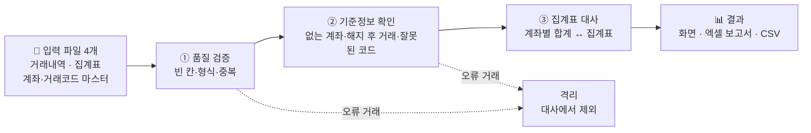
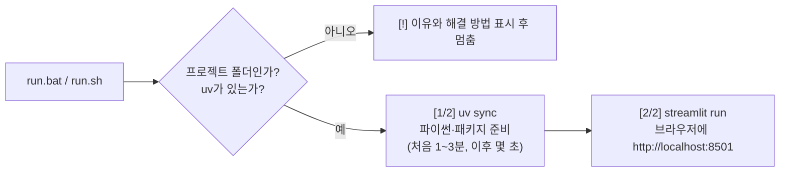
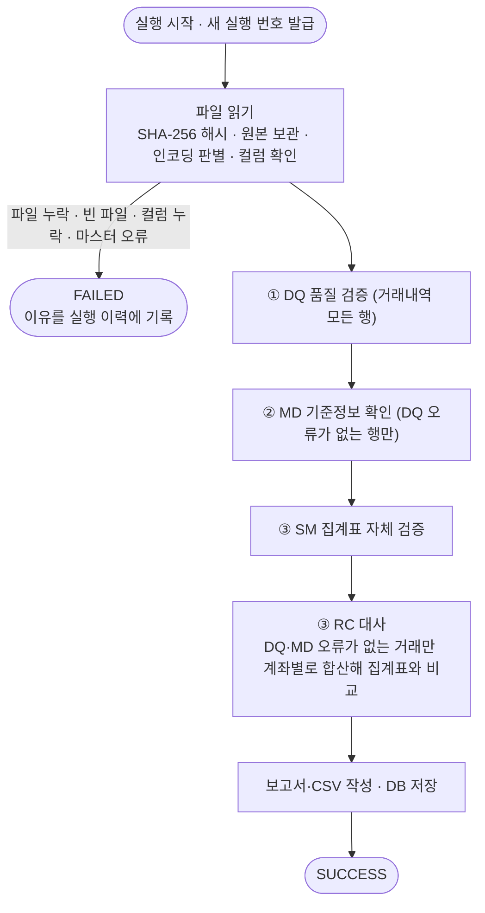
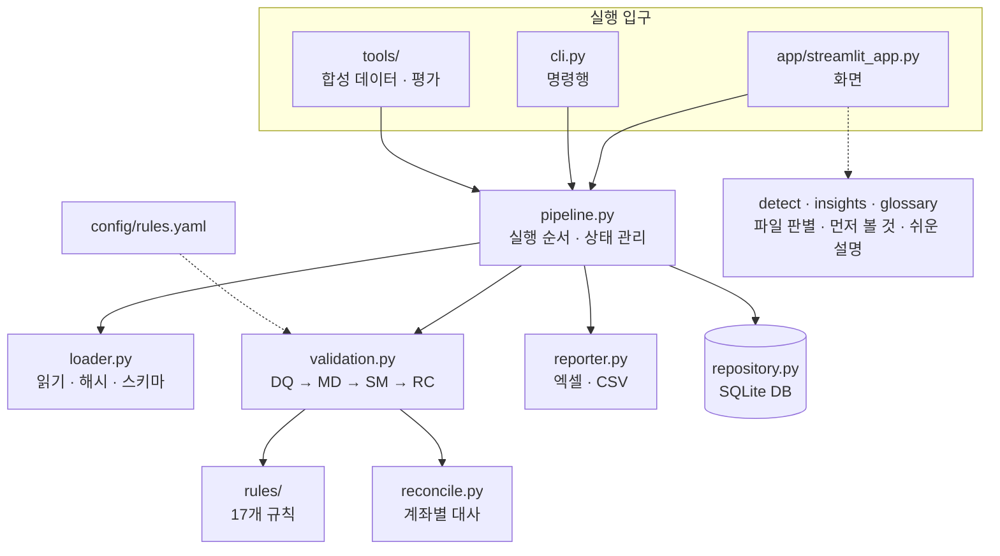

# Recon · 금융 데이터 검증·대사 자동화

하루치 계좌 거래내역 파일을 올리면 세 단계로 자동 검증합니다.
1. 오류가 있는 거래는 따로 빼 둡니다(격리).
2. 남은 정상 거래를 계좌별로 더해, 함께 받은 집계표와 맞는지 비교합니다(대사).
3. 결과를 화면과 엑셀 보고서로 정리합니다.

사람이 엑셀 필터와 VLOOKUP, 피벗으로 하던 일을 파일 4개 업로드로 대신합니다.



> 처음이라면 [빠른 시작](#빠른-시작)대로 실행한 뒤 **샘플로 1분 체험**을 눌러 보세요. 오류 81건을 심어 둔 합성 데이터로 전체 흐름을 바로 볼 수 있습니다.

## 목차

1. [빠른 시작](#빠른-시작)
2. [실행이 안 될 때](#실행이-안-될-때)
3. [사용 방법](#사용-방법)
4. [입력 파일](#입력-파일)
5. [검증 과정](#검증-과정)
6. [결과물](#결과물)
7. [명령행으로 실행](#명령행으로-실행)
8. [프로젝트 구조](#프로젝트-구조)
9. [설정과 확장](#설정과-확장)
10. [테스트와 품질 기준](#테스트와-품질-기준)
11. [웹 데모 배포](#웹-데모-배포)
12. [문서](#문서)

---

## 빠른 시작

준비물은 **uv** 하나입니다. 파이썬이 없어도 uv가 알아서 설치합니다.

| 단계 | Windows | macOS · Linux |
|---|---|---|
| ① 프로젝트 받기 | GitHub에서 **Code → Download ZIP** → ZIP을 **마우스 오른쪽 → 압축 풀기** | 같음 (또는 `git clone`) |
| ② uv 설치 (처음 한 번) | PowerShell에서<br/>`powershell -ExecutionPolicy ByPass -c "irm https://astral.sh/uv/install.ps1 \| iex"` | 터미널에서<br/>`curl -LsSf https://astral.sh/uv/install.sh \| sh` |
| ③ 실행 | 압축 푼 폴더의 **`run.bat` 더블클릭** | 압축 푼 폴더에서 **`sh run.sh`** |

실행하면 다음 순서로 진행됩니다.



- **실행 창은 열어 두세요.** 화면을 쓰는 동안 필요하고, 창을 닫으면 앱이 꺼집니다.
- **데이터는 이 컴퓨터에만 저장됩니다.** 모든 결과는 프로젝트 안의 `data/` 폴더에 쌓이고, 외부로 보내지 않습니다.

## 실행이 안 될 때

| 증상 | 원인 | 해결 |
|---|---|---|
| 창이 잠깐 떴다 사라지거나 아무 반응이 없음 | ZIP 안에서 바로 실행했거나 `run.bat`만 따로 받음. 예전 버전 `run.bat`(한글·LF 줄바꿈)을 쓰는 경우 | ZIP 전체를 받아 **압축을 푼 폴더**에서 최신 `run.bat` 실행 |
| `[!] run.bat must be started from inside the extracted project folder` | 위와 같음 | 압축을 푼 폴더에서 실행 |
| `[!] uv is not installed` | uv 미설치, 또는 설치 직후라 PATH에 아직 없음 | 빠른 시작 ②의 명령으로 설치하고, 창을 새로 열어 다시 실행 |
| "Windows의 PC 보호" 파란 창 | 인터넷에서 받은 파일에 대한 SmartScreen 경고 | **추가 정보 → 실행** |
| `[1/2]`에서 멈춘 것처럼 보임 | 첫 실행이라 파이썬과 패키지(약 150MB)를 받는 중 | 1~3분 기다리기 |
| 브라우저가 자동으로 안 열림 | 자동 열기가 막힌 환경 | 실행 창에 나온 주소(보통 `http://localhost:8501`)를 직접 열기. 포트가 이미 쓰이고 있으면 `8502`처럼 다른 번호가 나옴 |
| macOS에서 `run.sh`를 더블클릭하면 편집기가 열림 | macOS는 `.sh` 파일을 더블클릭으로 실행하지 않음 | 터미널에서 `sh run.sh` 실행, 또는 파일을 `run.command`로 복사해 더블클릭 |

창에 `[!]`로 시작하는 메시지가 보이면 그 안내를 따르세요. 그래도 안 되면 실행 창을 캡처해 공유해 주세요.

## 사용 방법

화면 위쪽 메뉴 5개를 왼쪽부터 차례로 쓰면 됩니다.

| 메뉴 | 하는 일 |
|---|---|
| **시작하기** | 이 도구가 하는 일, 동작 방식, 17개 규칙, 결과 읽는 법, 자주 묻는 질문 |
| **검증 실행** | ① 파일 4개를 한 번에 끌어다 놓기 (이름이 달라도 컬럼을 보고 어떤 파일인지 알아봄) → ② 기준일 확인 → ③ **검증 시작** |
| **결과** | 요약 대시보드(판정, 핵심 숫자, 거래 구성, 계좌 일치율), **먼저 확인할 것**(급한 순서, 할 일, 목록 바로가기), 차이 금액 상위 계좌·규칙별 오류 차트, 보고서 내려받기 |
| **상세 내역** | 오류 목록과 계좌별 대사 결과를 규칙·단계·계좌번호로 걸러 보기, 규칙 설명 |
| **실행 이력** | 지난 실행 목록, 재처리 연결, 예전 보고서 다시 받기 |

**결과를 보는 순서**
1. 맨 위 요약 대시보드에서 전체 상황을 봅니다.
2. **먼저 확인할 것**을 위에서부터 차례로 봅니다. 가장 급한 것은 "거래내역으로 설명되지 않는 차이"입니다.
3. 각 항목의 **목록 보기**를 누르면 해당 건만 걸러진 상세 내역으로 이동합니다.
4. 원천 파일을 고친 뒤 **검증 실행 → 재처리**에서 이전 실행을 골라 다시 돌립니다. 새 실행으로 남고 이전 결과는 그대로 보존됩니다.

**결과에 쓰이는 말**

| 표시 | 뜻 |
|---|---|
| 🟢 정상 반영 | 오류가 없어 계좌별 합계 계산에 쓰인 거래 |
| 🔴 격리 | 오류가 있어 대사에서 뺀 거래. 고친 뒤 다시 실행하면 됨 |
| 🟡 검토 필요 | 대사에는 넣었지만 의심 중복처럼 사람이 판단해야 하는 거래 |
| 🟠 계좌 차이 | 거래내역 합계와 집계표가 다른 계좌. 원인(제외 거래 있음 · 검토 거래 있음 · 원인 미상 · 잔액 계산 불일치)을 함께 표시 |

## 입력 파일

모든 파일은 **기준일 하루치**를 담습니다.
- **인코딩:** CSV는 UTF-8과 CP949(엑셀 기본) 모두 읽습니다.
- **선택 컬럼:** 표에서 *기울임*으로 쓴 컬럼은 없어도 됩니다.
- **자세한 형식:** 컬럼별 형식과 예는 [docs/데이터사전.md](docs/데이터사전.md)에 있습니다.

| 파일 (표준 이름) | 내용 | 필요한 컬럼 |
|---|---|---|
| `transactions.csv` | 거래내역 | `txn_id` `txn_dt` `account_no` `txn_code` `direction`(D/W) `amount` *`channel`* *`branch_code`* |
| `account_summary.xlsx` | 계좌별 일일 집계 | `base_date` `account_no` `opening_balance` `deposit_count` `deposit_amount` `withdrawal_count` `withdrawal_amount` `closing_balance` |
| `account_master.csv` | 계좌 마스터 | `account_no` `product_code` `status`(ACTIVE/CLOSED/SUSPENDED) `open_date` `close_date` |
| `txn_code_master.csv` | 거래코드 마스터 | `txn_code` `txn_name` `direction` `active_yn`(Y/N) |

- **화면에서 올릴 때:** 파일 이름은 달라도 됩니다. 컬럼을 보고 어떤 파일인지 알아봅니다.
- **명령행으로 실행할 때:** 폴더 안의 파일 이름이 위의 표준 이름과 같아야 합니다.
- **샘플 파일:** 검증 실행 화면의 **파일 형식 안내 → 샘플 파일 내려받기**에서 받거나, `tools/generate_data.py`로 만듭니다.

## 검증 과정

### 한 번의 실행 안에서 일어나는 일



- **ERROR와 WARN:** ERROR가 난 거래는 격리해 대사에서 빼고, WARN이 난 거래는 대사에 포함하되 검토 목록에 올립니다.
- **오류 기록:** 같은 단계 안에서는 한 행의 오류를 모두 기록합니다.
- **SUCCESS와 FAILED:** 데이터 오류가 많아도 결과는 SUCCESS입니다. FAILED는 파일 누락처럼 검증 자체를 할 수 없을 때만 나옵니다.

### 17개 규칙

| ID | 쉬운 이름 | 처리 | 무엇을 찾나 |
|---|---|---|---|
| DQ-01 | 빈 칸이 있는 거래 | 격리 | 필수 항목(거래번호·일시·계좌·코드·입출금 구분·금액) 중 빈 칸 |
| DQ-02 | 계좌번호 형식 오류 | 격리 | `123-45-678901` 형식이 아님 (엑셀이 앞자리 0을 지운 경우 포함) |
| DQ-03 | 거래일시 오류 | 격리 | 형식이 틀렸거나 기준일이 아닌 날짜 |
| DQ-04 | 금액 오류 | 격리 | 0 이하, 소수점·문자·전각 숫자 |
| DQ-05 | 입출금 구분 오류 | 격리 | D(입금)·W(출금)가 아님 |
| DQ-06 | 거래번호 중복 | 격리 | 같은 거래번호 2건 이상 (내용이 같으면 첫 건만 남김, 다르면 모두 격리) |
| DQ-07 | 의심 중복 | 검토 | 번호만 다르고 계좌·시각·코드·금액이 같음 |
| MD-01 | 등록되지 않은 계좌 | 격리 | 계좌 마스터에 없음 |
| MD-02 | 개설 전·해지 후 거래 | 격리 | 개설일 이전 또는 해지일 이후 거래 |
| MD-03 | 쓸 수 없는 거래코드 | 격리 | 마스터에 없거나 폐지된 코드 |
| MD-04 | 코드와 입출금 방향 불일치 | 격리 | 입금 코드인데 W처럼 방향이 다름 |
| MD-05 | 지급정지 계좌 출금 | 검토 | SUSPENDED 계좌의 출금 |
| SM-01 | 집계표 형식 오류 | 계좌 오류 | 집계표의 계좌 중복 행, 기준일·숫자 오류 → 그 계좌는 대사에서 제외 |
| RC-01 | 집계표 계좌 누락·초과 | 계좌 오류 | 기준일에 유효한 계좌가 집계표에 없음, 또는 없어야 할 계좌가 있음 |
| RC-02 | 입금 합계 불일치 | 계좌 오류 | 계좌별 입금 건수·금액 ≠ 집계표 |
| RC-03 | 출금 합계 불일치 | 계좌 오류 | 계좌별 출금 건수·금액 ≠ 집계표 |
| RC-04 | 잔액 계산 불일치 | 계좌 오류 | 집계표의 기초 + 입금 − 출금 ≠ 기말 |

판단 기준 원문, 걸리는 예와 걸리지 않는 예는 [docs/업무규칙서.md](docs/업무규칙서.md)에 있습니다.

## 결과물

실행할 때마다 `data/output/run_{실행번호}/`에 아래 파일이 생기고, 화면에서도 내려받을 수 있습니다.

| 파일 | 내용 |
|---|---|
| `report_{번호}.xlsx` | 엑셀 보고서. **요약**(건수·입력 파일·규칙별 건수), **오류목록**, **대사결과**(계좌별 거래 합계 vs 집계표, 차이 원인), **검토대상**(WARN) 4개 시트 |
| `quarantine_transactions.csv` | 격리된 거래와 오류 사유. 원천 데이터를 고칠 때 씀 |
| `clean_transactions.csv` | 대사에 쓰인 정상 거래 (검토 거래 포함) |
| `run.log` | 단계별 시작·종료와 건수 |

모든 저장 위치는 `data/` 아래이며, 이 폴더는 git에 올라가지 않습니다.

| 경로 | 내용 |
|---|---|
| `data/recon.db` | 실행 이력 DB (SQLite) |
| `data/archive/` | 올린 원본 파일 보관 (`해시 앞 16자_파일명`). 같은 파일을 다시 올리면 경고를 띄움 (실행은 계속됨) |
| `data/output/run_{번호}/` | 위 결과 파일 |
| `data/sample/` | `tools/generate_data.py`로 만든 합성 데이터 |

## 명령행으로 실행

화면 없이 돌리거나 스케줄러에 붙일 때 씁니다. 화면과 같은 엔진(`pipeline.py`)을 호출하므로 결과도 같습니다. 아래 명령은 모두 프로젝트 폴더에서 실행합니다.

```bash
# 1) 합성 데이터 만들기 → data/sample/clean (오류 없음), data/sample/injected (오류 81건 + 정답 파일)
uv run python tools/generate_data.py [--out-dir 폴더] [--seed 42] [--base-date 2026-10-15]

# 2) 검증 실행: 표준 이름의 파일 4개가 있는 폴더를 지정
uv run python cli.py run --input-dir data/sample/injected --base-date 2026-10-15

# 3) 재처리: 고친 파일이 있는 폴더 + 이전 실행 번호
uv run python cli.py run --input-dir <고친 파일 폴더> --base-date 2026-10-15 --parent-run-id 1

# 4) 실행 이력 보기
uv run python cli.py runs

# 5) 정답 파일 대비 평가 (재현율 100%·오탐 0건이 아니면 종료 코드 1)
uv run python tools/evaluate.py [--data-dir data/sample/injected] [--run-id 번호]
```

`cli.py run`의 종료 코드는 다음과 같습니다.

| 코드 | 뜻 |
|---|---|
| `0` | SUCCESS |
| `1` | FAILED (원인을 출력) |
| `2` | 입력 폴더가 없음 |

## 프로젝트 구조

### 구성 요소의 관계



### 폴더

```
├─ run.bat · run.sh          원클릭 실행 (Windows · macOS/Linux)
├─ app/
│  ├─ streamlit_app.py       화면 5개 (시작하기 · 검증 실행 · 결과 · 상세 내역 · 실행 이력)
│  ├─ ui.py                  스타일(디자인 토큰)과 화면 구성 요소
│  └─ static/fonts/          Pretendard 폰트 (OFL 라이선스, 인터넷 없이도 같은 글꼴)
├─ cli.py                    명령행 실행
├─ config/rules.yaml         정규식 · 금액 허용오차 · 규칙 켜고 끄기
├─ src/recon/                검증 엔진 (패키지 이름 recon)
│  ├─ loader.py              파일 읽기, 인코딩·컬럼 확인, 해시, 원본 보관
│  ├─ rules/                 registry.py(등록·실행) · context.py · dq.py · md.py · sm.py · rc.py
│  ├─ reconcile.py           집계표 분석, 계좌별 대사 계산
│  ├─ validation.py          단계별 실행, 정상·격리 분리, 건수 집계
│  ├─ pipeline.py            전체 실행 순서, 실행 상태(PENDING→RUNNING→SUCCESS/FAILED)
│  ├─ reporter.py            엑셀 보고서 · CSV
│  ├─ repository.py          DB 저장·조회 (SQLAlchemy)
│  ├─ detect.py              업로드 파일 종류 자동 판별
│  ├─ insights.py            결과 판정, 먼저 확인할 것 목록
│  ├─ glossary.py            규칙·원인·파일의 쉬운 설명
│  ├─ synthetic.py           합성 데이터 + 오류 주입 + 정답 파일
│  ├─ evaluation.py          정답 대비 재현율·오탐 계산
│  └─ config.py · models.py · paths.py · values.py   설정 읽기, 공통 정의, 경로, 값 해석
├─ tools/                    generate_data.py · evaluate.py
├─ tests/                    단위·경계값·통합·실패 상황·화면 테스트
├─ docs/                     설계서 · 업무규칙서 · 데이터사전 · 디자인 기준
├─ .streamlit/config.toml    화면 테마 · 폰트 · 업로드 한도
├─ .github/workflows/ci.yml  자동 테스트 (GitHub Actions)
├─ pyproject.toml · uv.lock  의존성 (uv)
└─ requirements.txt          Streamlit Cloud용 의존성 (uv.lock에서 생성)
```

## 설정과 확장

### 설정

| 무엇을 | 어디서 |
|---|---|
| 계좌번호 정규식, 날짜 형식, 금액 허용오차(기본 0원) | `config/rules.yaml` |
| 규칙 켜고 끄기 | `config/rules.yaml`의 `rules:` (`false`면 실행 안 함) |
| 오래 멈춘 실행을 실패로 정리하는 시간 (기본 60분) | `config/rules.yaml`의 `runtime.stale_running_minutes` |
| 데이터 저장 폴더 | 환경변수 `RECON_DATA_DIR` (기본 `data/`) |
| DB | 환경변수 `DATABASE_URL` (기본 `sqlite:///data/recon.db`, PostgreSQL 주소로 바꿀 수 있음) |
| 화면 색·폰트 | `.streamlit/config.toml`, `app/ui.py` |

### 규칙을 하나 추가하려면

1. `src/recon/rules/`의 해당 단계 파일에 `@register("DQ-08", "이름", severity=ERROR, file_type=TRANSACTIONS)` 함수를 추가합니다. 엔진 코드는 바꾸지 않아도 됩니다.
2. `config/rules.yaml`의 `rules:`에 `DQ-08: true`를 추가합니다.
3. `src/recon/glossary.py`의 `RULE_GUIDES`에 쉬운 설명을 추가합니다. 화면과 결과 차트에 쓰입니다.
4. 규칙 테스트(`tests/test_rules_*.py`)와 [docs/업무규칙서.md](docs/업무규칙서.md)를 함께 갱신합니다.

## 테스트와 품질 기준

```bash
uv sync                  # 개발용 의존성까지 설치 (.venv)
uv run pytest            # 테스트 186개
```

| 기준 | 내용 |
|---|---|
| 깨끗한 합성 데이터 (거래 5,002건) | 오류 0건, 192개 계좌 모두 일치 |
| 오류 주입 데이터 (오류 81건) | 17개 규칙 모두 **재현율 100%, 오탐 0건** (`tools/evaluate.py`) |
| 테스트 | 규칙별 걸리는/걸리지 않는 경우, 경계값, 통합, 실패 상황(파일 누락·빈 파일·컬럼 오류·CP949·재업로드·강제 중단 정리), 화면 흐름, 실행 스크립트 |
| 지원 버전 | Python 3.11 이상, pandas 2.2 이상 |

**CI:** push와 PR마다 GitHub Actions(`.github/workflows/ci.yml`)가 테스트, 합성 데이터 생성, 평가를 차례로 실행합니다.

**의존성을 바꿨다면:** `uv lock`을 실행한 뒤 `requirements.txt`를 다시 만드세요.

```bash
uv export --no-dev --no-hashes --no-header --no-annotate --format requirements-txt > requirements.txt
```

## 웹 데모 배포

설치 없이 링크로 보여 주고 싶을 때 Streamlit Community Cloud를 씁니다.

1. [share.streamlit.io](https://share.streamlit.io)에 GitHub 계정으로 로그인합니다.
2. **Create app**을 누르고 이 저장소와 브랜치를 고릅니다. Main file path에는 `app/streamlit_app.py`를 입력합니다.
3. 의존성은 `requirements.txt`로 자동 설치됩니다.

**주의할 점**
- **실제 금융 데이터는 올리지 마세요.** 공개 서버이므로 합성 데이터(샘플 버튼)만 쓰는 데모 용도입니다.
- **데이터가 지워질 수 있습니다.** 앱이 재시작되면 실행 이력과 보고서 파일이 사라질 수 있습니다.

## 문서

| 문서 | 내용 |
|---|---|
| [docs/설계서.md](docs/설계서.md) | 목적, 대상 업무, 처리 흐름, DB, 일정, 구현 결정 사항 |
| [docs/업무규칙서.md](docs/업무규칙서.md) | 17개 규칙의 판단 기준과 예시, 공통 처리 원칙 |
| [docs/데이터사전.md](docs/데이터사전.md) | 입력·출력 파일, DB 테이블, 정답 파일 컬럼 |
| [docs/DESIGN-meta.md](docs/DESIGN-meta.md) | 화면 디자인 기준 (색·글꼴·모서리·버튼) |
