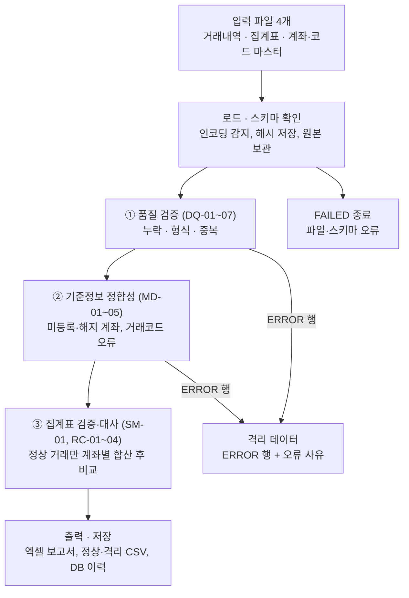

# 금융 데이터 검증·대사 자동화 설계서

2026-10-15 · 베스트

## 1. 개요

이 프로젝트는 하루치 계좌 거래내역을 받아 품질 검증, 기준정보 정합성 검증, 집계자료와의 대사를 자동 수행하고 오류 보고서와 실행 이력을 남기는 4주짜리 MVP입니다. LLM 없이 완성하며, 여기서 만든 검증 엔진은 이후 재무제표 등록·이상거래 탐지 과제에서 재사용합니다.

**목표**

- 수작업 엑셀 대사를 대체하는 재현 가능한 검증 파이프라인 완성
- 심어둔 오류를 100% 탐지하고, 정상 데이터에서는 오탐 0건 달성
- 원본 보존, 실행 이력, 재처리까지 갖춘 운영형 구조 경험

**대상 업무 (3개)**

1. 거래내역 데이터 품질 검증 — 파일 하나 안의 누락·형식·중복 오류
2. 기준정보 정합성 검증 — 계좌 마스터·거래코드 마스터와 거래내역 비교
3. 거래내역 ↔ 계좌별 집계 대사 — 건수·금액·잔액 일치 여부

이 3개를 고른 이유는 은행 데이터 오류의 대부분이 이 세 단계에서 걸러지고, 셋이 순서대로 연결되어 하나의 파이프라인을 이루기 때문입니다.

**범위 제외**

- 실시간 처리 (일 단위 배치만)
- 외화 (원화 KRW만)
- 여러 영업일 연속 대사 (단일 기준일만, 확장 항목으로 남김)
- 사용자 인증·권한, LLM 기능

## 2. 대상 업무 정의

세 업무는 앞 단계를 통과한 데이터만 다음 단계로 넘기는 순차 구조입니다.

| 업무 | 현행 수작업 방식 | 자동화 후 | 실무 대응 업무 |
|---|---|---|---|
| ① 품질 검증 | 엑셀 필터로 빈 칸·이상값 확인 | 규칙 기반 자동 판정, 오류 행 격리 | 배치 적재 전 데이터 검증, 보고서 원천 점검 |
| ② 기준정보 정합성 | 마스터 파일과 VLOOKUP 비교 | 마스터 조인으로 미등록·해지·코드 오류 탐지 | 계정계·정보계 간 코드 정합성 점검 |
| ③ 거래-집계 대사 | 피벗 합계를 집계표와 눈으로 비교 | 계좌별 건수·금액·잔액 자동 비교, 차이 원인 표시 | 원장-보고서 대사, 일계 마감 점검 |

**업무별 핵심 질문**

- ① 이 거래 행은 형식상 처리 가능한가?
- ② 이 거래는 존재하고 유효한 계좌·거래코드로 발생했는가?
- ③ 거래내역을 합산한 결과가 집계표의 숫자와 일치하는가? 다르다면 어느 계좌에서 얼마나 다른가?

## 3. 입력 데이터 명세

입력은 파일 4개이며, 모든 파일은 기준일 하루치를 담습니다. 계좌번호는 반드시 문자열로 읽습니다(엑셀이 숫자로 바꾸면 앞자리 0이 사라지는 실무 사고를 막기 위함).

**① transactions.csv — 거래내역**

| 컬럼 | 타입 | 필수 | 설명 |
|---|---|---|---|
| txn_id | 문자열 | Y | 거래 고유번호 (예: T20261015000001) |
| txn_dt | 일시 | Y | 거래일시 YYYY-MM-DD HH:MM:SS |
| account_no | 문자열 | Y | 계좌번호 형식 123-45-678901 |
| txn_code | 문자열 | Y | 거래코드 (거래코드 마스터 참조) |
| direction | 문자열 | Y | D(입금) / W(출금) |
| amount | 정수 | Y | 거래금액, 원 단위, 0보다 큼 |
| channel | 문자열 | N | BRANCH / ATM / MOBILE / INTERNET |
| branch_code | 문자열 | N | 처리 영업점 코드 4자리 |

**② account_summary.xlsx — 계좌별 일일 집계**

| 컬럼 | 타입 | 설명 |
|---|---|---|
| base_date | 날짜 | 기준일 |
| account_no | 문자열 | 계좌번호 |
| opening_balance | 정수 | 기초잔액 |
| deposit_count / deposit_amount | 정수 | 입금 건수 / 금액 |
| withdrawal_count / withdrawal_amount | 정수 | 출금 건수 / 금액 |
| closing_balance | 정수 | 기말잔액 |

**집계 대상 계좌:** 기준일에 유효한 계좌 전부입니다. open_date ≤ 기준일이고 close_date가 비어 있거나 기준일 이후(당일 포함)인 계좌이며, 거래가 0건이어도 0으로 1행을 둡니다. 기준일 이전에 해지됐거나 기준일 이후 개설된 계좌는 넣지 않습니다.

**③ account_master.csv — 계좌 마스터**

| 컬럼 | 설명 |
|---|---|
| account_no | 계좌번호 (기본키) |
| product_code | 상품코드 |
| status | ACTIVE / CLOSED / SUSPENDED |
| open_date / close_date | 개설일 / 해지일 (해지 전이면 빈 값) |

**④ txn_code_master.csv — 거래코드 마스터**

| 컬럼 | 설명 |
|---|---|
| txn_code | 거래코드 (기본키) |
| txn_name | 거래명 (예: 현금입금, 계좌이체출금) |
| direction | 이 코드가 허용하는 방향 D / W |
| active_yn | 사용 여부 Y / N |

인코딩은 UTF-8과 CP949를 모두 받아들이고, 어느 쪽으로 읽었는지 실행 이력에 기록합니다.

## 4. 검증 규칙

규칙은 17개이며, 심각도에 따라 처리 방식이 다릅니다. ERROR는 해당 행을 격리해 다음 단계에서 제외하고, WARN은 통과시키되 검토 목록에 올립니다.

**① 품질 검증 (DQ)**

| ID | 규칙 | 판단 기준 | 심각도 |
|---|---|---|---|
| DQ-01 | 필수값 누락 | 필수 컬럼이 빈 값 또는 공백뿐 | ERROR |
| DQ-02 | 계좌번호 형식 | 정규식 `^\d{3}-\d{2}-\d{6}$` 불일치 | ERROR |
| DQ-03 | 거래일시 형식·범위 | 파싱 실패 또는 날짜가 기준일과 다름 | ERROR |
| DQ-04 | 금액 형식 | 천 단위 쉼표 제거 후 정수가 아니거나 0 이하 | ERROR |
| DQ-05 | 입출금 구분 값 | D / W 이외의 값 | ERROR |
| DQ-06 | 거래번호 중복 | 같은 txn_id가 2건 이상. 내용이 모두 같으면 첫 건만 유지하고 나머지 격리, 내용이 다르면 전부 격리 | ERROR |
| DQ-07 | 의심 중복 | txn_id는 다르나 계좌·일시·코드·금액이 모두 같음 | WARN |

**② 기준정보 정합성 (MD)**

| ID | 규칙 | 판단 기준 | 심각도 |
|---|---|---|---|
| MD-01 | 미등록 계좌 | 계좌 마스터에 없는 account_no | ERROR |
| MD-02 | 계좌 유효기간 외 거래 | 거래일 < open_date, 또는 CLOSED이고 거래일 > close_date | ERROR |
| MD-03 | 미등록·폐지 거래코드 | 코드 마스터에 없거나 active_yn = N | ERROR |
| MD-04 | 코드-방향 불일치 | 거래의 direction ≠ 코드 마스터의 direction | ERROR |
| MD-05 | 지급정지 계좌 출금 | status = SUSPENDED이고 direction = W | WARN |

**③ 집계표 검증·거래-집계 대사 (SM·RC)**

| ID | 규칙 | 판단 기준 | 심각도 |
|---|---|---|---|
| SM-01 | 집계표 자체 오류 | 계좌 중복 행, base_date ≠ 기준일, 건수·금액이 숫자가 아니거나 음수 → 계좌당 1건 기록, 해당 계좌는 RC-01~04 검사에서 모두 제외하고 대사결과에 "집계표 오류로 대사 제외" 표시 | ERROR |
| RC-01 | 계좌 존재 불일치 | 집계 대상 계좌(3장 ②)가 집계표에 없음(거래 유무와 무관), 또는 집계표에 있으나 집계 대상이 아닌 계좌(마스터에 없거나 기준일에 유효하지 않음). SM-01로 제외된 계좌는 검사하지 않음 | ERROR |
| RC-02 | 입금 불일치 | 계좌별 입금 건수 또는 합계 ≠ 집계표 | ERROR |
| RC-03 | 출금 불일치 | 계좌별 출금 건수 또는 합계 ≠ 집계표 | ERROR |
| RC-04 | 잔액 등식 불일치 | 기초 + 입금 − 출금 ≠ 기말 (집계표 자체 검증) | ERROR |

금액 허용오차는 원화 기준 0원(완전 일치)이며, 설정 파일에서 변경할 수 있습니다. 정규식·허용오차·규칙 사용 여부는 모두 `rules.yaml`에 두고 코드에 하드코딩하지 않습니다.

## 5. 처리 흐름과 핵심 설계 결정



*처리 흐름 · 3단계 검증, 격리, 출력*

파일 자체를 못 읽으면 실행을 FAILED로 끝내고, 읽은 뒤의 ERROR 행은 격리해 대사에서 제외합니다. 격리 행이 있는 계좌의 대사 차이에는 "제외 거래 있음" 표시가 붙습니다.

**핵심 설계 결정**

1. **원본은 절대 수정하지 않는다.** 업로드 파일은 SHA-256 해시와 함께 원본 보관 폴더에 저장하고, 모든 처리는 복사본으로 합니다. 같은 해시의 파일이 다시 들어오면 "이미 처리된 파일"로 경고합니다.
2. **단계별로 걸러서 넘긴다.** DQ ERROR 행은 MD 검사를 받지 않고(깨진 계좌번호가 MD-01을 중복으로 일으키는 것을 막기 위함), DQ·MD ERROR 행은 대사에서 제외합니다. WARN 행은 다음 단계로 넘어갑니다.
3. **대사 차이에는 원인 표시를 붙인다.** 차이가 난 계좌마다 "제외 거래 있음" / "검토 거래 있음(WARN 행 포함)" / "원인 미상" 중 하나를 표시합니다. 계좌번호 자체가 깨진 격리 행은 계좌에 연결할 수 없으므로, 보고서 요약에 "계좌 미식별 격리 N건"을 따로 보여줍니다.
4. **중복 처리 기준을 명확히 한다.** DQ-06은 내용이 같으면 첫 건만 유지, 내용이 다르면 전부 격리합니다(어느 쪽이 맞는지 시스템이 판단할 수 없음). DQ-07 의심 중복은 둘 다 유지합니다.
5. **같은 단계 안에서는 한 행의 오류를 모두 기록한다.** 첫 오류에서 멈추지 않아야 담당자가 한 번에 고칠 수 있습니다.
6. **재처리는 새 실행으로 남긴다.** 수정 파일로 다시 돌리면 새 run_id를 발급하고, 이전 실행을 parent_run_id로 연결합니다. 이전 결과는 덮어쓰지 않습니다.
7. **규칙은 등록 방식으로 구현한다.** 각 규칙은 동일한 인터페이스(입력 데이터 → 오류 목록)를 갖는 함수로 만들고 레지스트리에 등록합니다. 규칙 추가 시 엔진 코드는 바뀌지 않습니다.
8. **금액은 정수로만 다룬다.** 모든 파일을 일단 문자열로 읽은 뒤 검증을 통과한 값만 int64로 변환합니다. float을 쓰면 큰 금액 합산에서 오차가 생길 수 있습니다.

## 6. 출력물

실행 1회당 엑셀 보고서 1개, 정상·격리 데이터 파일 2개, DB 실행 이력 1건이 생성됩니다.

**엑셀 보고서 (report_{run_id}.xlsx)**

| 시트 | 내용 |
|---|---|
| 요약 | 기준일, 입력 파일·해시, 총 건수, 정상·격리 건수, 규칙별 오류 건수, 대사 일치·불일치 계좌 수, 계좌 미식별 격리 건수 |
| 오류목록 | rule_id, 심각도, 파일, 원본 행번호, 키(txn_id 또는 account_no), 컬럼, 값, 메시지 |
| 대사결과 | 계좌별 거래 합산값 / 집계표 값 / 차이 (입금 건수·금액, 출금 건수·금액), 차이 원인 표시 |
| 검토대상 | WARN 건 목록 (의심 중복 등) |

**데이터 파일**

- clean_transactions.csv — 모든 ERROR 규칙을 통과한 거래
- quarantine_transactions.csv — 격리된 거래 + 오류 사유 컬럼

**화면 (Streamlit, 4개 탭)**

1. 실행: 파일 4개 업로드 → 기준일 선택 → 실행 버튼
2. 결과 요약: 건수 카드, 규칙별 오류 막대그래프, 보고서 다운로드
3. 상세: 오류목록·대사결과 표, 규칙·계좌·심각도 필터
4. 실행 이력: 과거 실행 목록, 재처리 연결 관계, 이전 보고서 재다운로드

## 7. 시스템 구조와 DB 설계

**기술 스택:** Python 3.11+, pandas, openpyxl, SQLAlchemy, SQLite, Streamlit, pytest, PyYAML

**DB 선택 — SQLite:** 리포를 클론한 누구나 서버 설치 없이 바로 실행할 수 있고, GitHub Actions에서도 별도 DB 설정 없이 테스트가 돕니다. DB 접근은 SQLAlchemy로만 하고 접속 주소는 환경변수 `DATABASE_URL`로 받습니다. 기본값은 `sqlite:///data/recon.db`이며, 주소만 바꾸면 PostgreSQL로 전환할 수 있습니다. DB 파일과 data/ 폴더는 .gitignore에 넣고, 테이블은 첫 실행 시 자동 생성합니다.

**리포 운영:** main 브랜치에 push할 때마다 GitHub Actions로 pytest와 evaluate.py를 실행해, 재현율 100%·오탐 0건이 깨지면 실패로 표시합니다. 합성 데이터는 커밋하지 않고 시드 고정으로 매번 생성합니다.

**폴더 구조**

```
(저장소 루트)
  config/rules.yaml        # 정규식, 허용오차, 규칙 on/off, RUNNING 정리 시간
  src/recon/               # 패키지 이름 recon (src 레이아웃)
    loader.py              # 파일 읽기, 인코딩·스키마 확인, 해시, 원본 보관
    rules/
      registry.py          # 규칙 등록·실행
      context.py           # 규칙이 함께 쓰는 입력·중간 결과
      dq.py  md.py  sm.py  rc.py  # 업무별 규칙
    reconcile.py           # 집계표 분석, 계좌별 대사 계산
    validation.py          # DQ→MD→SM→RC 실행, 정상·격리 분리
    pipeline.py            # 전체 실행 순서, run 상태 관리
    reporter.py            # 엑셀·CSV 출력
    repository.py          # DB 저장·조회
    synthetic.py           # 합성 데이터 + 오류 주입 (화면의 샘플 버튼도 사용)
    evaluation.py          # 정답 대비 재현율·오탐 계산
  app/streamlit_app.py     # 화면
  cli.py                   # 명령행 실행 (스케줄러 연결용)
  tools/generate_data.py   # 합성 데이터 생성 (synthetic.py 호출)
  tools/evaluate.py        # 평가 (evaluation.py 호출, CI에서 사용)
  run.sh  run.bat          # 원클릭 실행
  tests/
  docs/                    # 설계서, 업무규칙서, 데이터사전
```

화면(app)과 명령행(cli)은 같은 pipeline.py를 호출합니다. 4순위 과제에서 스케줄러를 붙일 때 cli만 연결하면 됩니다.

**DB 테이블**

| 테이블 | 주요 컬럼 | 용도 |
|---|---|---|
| runs | run_id, parent_run_id, base_date, status, started_at, finished_at, error_message | 실행 1회 = 1행 |
| input_files | run_id, file_type, file_name, sha256, encoding, row_count | 입력 원본 추적 |
| issues | run_id, rule_id, severity, file_type, row_no, record_key, column_name, value, message | 오류 1건 = 1행 |
| recon_results | run_id, account_no, 항목별 거래값·집계값·차이, diff_cause | 계좌별 대사 결과 |
| rule_stats | run_id, rule_id, hit_count | 규칙별 건수 (추이 확인용) |

**runs.status 상태:** PENDING → RUNNING → SUCCESS / FAILED. FAILED는 파일 누락·스키마 오류처럼 검증 자체를 못 한 경우이며, 데이터 오류가 많은 것은 SUCCESS입니다.

## 8. 합성 데이터와 평가 방법

깨끗한 데이터를 먼저 만들고, 정해진 오류를 정해진 개수만큼 심은 뒤, 심은 위치를 정답 파일로 저장합니다. 검증 결과를 정답 파일과 비교해 재현율과 오탐을 계산합니다.

**깨끗한 데이터 생성 (시드 고정)**

- 계좌 200개 (ACTIVE 185, CLOSED 10, SUSPENDED 5), 거래코드 12개 (입금 6, 출금 6, 폐지 코드 1개 포함)
- 기준일 하루 거래 약 5,000건, 출금은 잔액을 넘지 않도록 생성
- 거래는 각 계좌의 개설일~해지일 사이에서만 만들고, SUSPENDED 계좌에는 입금만 생성
- 집계표는 집계 대상 계좌 전부(거래 0건 계좌 최소 3개 포함)에 대해 깨끗한 거래내역을 합산해 정확히 계산 → 이 상태에서 검증하면 오류 0건이어야 함

**오류 주입 (injected_errors.csv에 정답 기록)**

| 주입 오류 | 건수 | 기대 규칙 |
|---|---|---|
| 필수값 삭제 | 10 | DQ-01 |
| 계좌번호 하이픈 제거·자릿수 변경 | 8 | DQ-02 |
| 거래일을 전일로 변경 | 5 | DQ-03 |
| 금액 음수·0·소수점 | 8 | DQ-04 |
| direction에 잘못된 값 | 3 | DQ-05 |
| 거래 행 그대로 복제 | 6 | DQ-06 |
| 같은 txn_id에 다른 내용 | 2 | DQ-06 |
| txn_id만 바꿔 복제 | 4 | DQ-07 |
| 마스터에 없는 계좌로 변경 | 5 | MD-01 |
| 해지 계좌의 해지일 이후 거래, 개설일 이전 거래 | 4 | MD-02 |
| 폐지·미등록 거래코드 | 5 | MD-03 |
| 입금 코드에 W 방향 | 4 | MD-04 |
| 지급정지 계좌에 출금 추가 | 3 | MD-05 |
| 집계표 계좌 행 중복 | 2 | SM-01 |
| 집계표 계좌 행 삭제(거래 0건 계좌 1개 포함), 마스터에 없는 계좌 행 추가 | 3 | RC-01 |
| 집계표 입금 건수·금액 변조 | 3 | RC-02 |
| 집계표 출금 건수·금액 변조 | 3 | RC-03 |
| 집계표 기말잔액 변조 | 3 | RC-04 |

**평가 지표**

- 정답 파일 컬럼: error_id, expected_rule, file, row_no, record_key, original_account_no. row_no는 주입 후 파일의 원본 행번호, original_account_no는 오류를 심기 전의 계좌번호이며, 한 행에 기대 규칙 1개만 기록합니다
- 매칭 기준: 거래내역 오류는 (file, row_no, expected_rule), 집계표 오류는 (file, account_no, expected_rule)로 탐지 결과와 짝짓습니다. txn_id가 지워지거나 중복된 행도 행번호로 구분됩니다.
- 중복 주입 기록: 그대로 복제한 행(DQ-06)은 원본보다 뒤에 넣고 복제 행만 정답에 기록합니다. 같은 txn_id에 다른 내용을 넣은 경우는 엔진이 두 행 모두 격리하므로 두 행을 같은 error_id로 기록합니다.
- 재현율 = 탐지한 주입 오류 수 / 주입 오류 수 (규칙별, 전체) → 목표 100%
- 오탐 = 정답 파일로 설명되지 않는 탐지 건수 → 목표 0건
- 연쇄 차이 처리: 거래내역에 심은 오류는 원래 계좌의 대사 차이(RC-02·03)를 함께 만듭니다. evaluate.py는 original_account_no 기준으로 이 차이를 "예상된 연쇄"로 분류해 오탐에서 뺍니다. 계좌번호를 깨뜨린 오류는 시스템이 계좌를 알 수 없으므로, 평가는 제품의 원인 표시가 아니라 정답 파일을 기준으로 합니다. 집계표 입금·출금 금액 변조는 잔액 등식도 깨므로, 같은 계좌의 RC-04는 "예상된 연쇄"로 분류합니다. 건수만 바꾼 경우에는 RC-04가 나오지 않아야 합니다.

## 9. 테스트 계획

테스트는 네 묶음으로 나누며, AI가 생성한 코드는 이 테스트를 통과해야만 완료로 봅니다.

**단위 테스트 (규칙별)** — 규칙마다 걸려야 하는 경우와 걸리면 안 되는 경우를 최소 2개씩 작성

**경계값·실무 함정 케이스**

- 금액 0원, 1원, 매우 큰 금액 (10억 이상)
- 기준일 00:00:00, 23:59:59 거래
- 공백만 있는 값, 앞뒤 공백, 전각 숫자(０１２)
- 엑셀이 숫자로 바꾼 계좌번호 (앞자리 0 손실)
- 해지일·개설일 당일 거래 (정상) vs 해지일 다음날·개설일 전날 거래 (MD-02)
- 거래가 0건인 계좌 (집계표에 0으로 존재 → 정상)
- 한 행에 같은 단계 오류 3개가 동시에 있는 경우 (3건 모두 기록), DQ 오류 행이 MD 검사를 건너뛰는지 확인

**통합 테스트**

- 깨끗한 데이터 → 오류 0건, 대사 전 계좌 일치
- 오류 주입 데이터 → evaluate.py 결과 재현율 100%, 오탐 0건
- 같은 입력으로 두 번 실행 → 결과 동일 (재현성)

**실패 상황 테스트**

- 파일 1개 누락, 빈 파일, 컬럼명 다름·컬럼 누락 → status FAILED, 원인 메시지 기록
- CP949 파일 입력 → 정상 처리, 인코딩 기록
- 같은 파일 재업로드 → 중복 처리 경고
- 처리 중 강제 중단 → 다음 실행 시작 시 일정 시간 넘게 RUNNING인 실행을 FAILED로 정리 (중단된 프로세스는 스스로 상태를 바꿀 수 없음)

## 10. 4주 일정과 완료 기준

주당 5~8시간 기준이며, 각 주의 완료 기준을 모두 충족해야 다음 주로 넘어갑니다.

**1주차 · 업무 정의와 합성 데이터**

- [x] docs/업무규칙서.md: 17개 규칙의 판단 기준과 예시 확정
- [x] docs/데이터사전.md: 4개 파일 컬럼 정의
- [x] rules.yaml 초안
- [x] generate_data.py: 깨끗한 데이터 + 오류 주입 + 정답 파일 생성

- 완료 기준: 깨끗한 집계표의 잔액 등식이 전 계좌에서 성립하고, 정답 파일 건수가 주입 계획과 일치

**2주차 · 검증 엔진과 단위 테스트**

- [x] loader.py: 인코딩 감지, 스키마 확인, 계좌번호 문자열 처리, 해시
- [x] 규칙 레지스트리와 DQ·MD·SM·RC 17개 규칙
- [x] 규칙별 단위 테스트, 경계값 케이스
- [x] evaluate.py

- 완료 기준: 명령행 실행으로 재현율 100%, 오탐 0건, 전체 테스트 통과

**3주차 · 보고서, DB, 화면**

- [x] reporter.py: 엑셀 4개 시트, 정상·격리 CSV
- [x] repository.py와 5개 테이블
- [x] Streamlit 4개 탭

- 완료 기준: 화면에서 업로드부터 보고서 다운로드까지 한 번에 동작, DB에 실행 이력 저장

**4주차 · 운영 기능과 마무리**

- [x] 재처리(parent_run_id), 중복 업로드 경고, 실패 상태 정리
- [x] 실행 로그 파일 (단계별 시작·종료·건수)
- [x] 실패 상황 테스트 전체
- [ ] README, 아키텍처 그림, 회고 (잘된 점, AI 코드에서 발견한 오류 유형) — README·아키텍처 그림 완료, 회고 남음

- 완료 기준: 9장 테스트 전부 통과, 처음 보는 사람이 README만으로 실행 가능

## 11. AI 코딩 진행 방식, 리스크, 확장

**AI 코딩 도구 활용 원칙**

- 이 설계서와 업무규칙서를 저장소에 넣고, AI에게 "docs를 읽고 구현하라"고 지시합니다. 매번 대화로 설명하지 않습니다.
- 모듈 단위로 요청합니다. 한 번에 전체를 만들게 하면 검토가 불가능합니다.
- 규칙 구현 전에 테스트를 먼저 쓰게 하고, 테스트 내용은 직접 검토합니다. 테스트가 틀리면 코드도 틀린 채로 통과합니다.
- 변경된 파일과 이유를 매번 요약하게 하고, diff를 직접 읽습니다.
- AI 코드에서 발견한 오류를 회고 문서에 기록합니다. 이 기록이 실무에서 AI 결과물을 검토하는 기준이 됩니다.

**주요 리스크와 대응**

| 리스크 | 대응 |
|---|---|
| 합성 데이터가 너무 깨끗해 실무 오류 유형을 놓침 | 경계값 케이스(9장)를 데이터 생성에도 반영 |
| 대사 연쇄 오류를 오탐으로 잘못 집계 | 제외 거래 표시 규칙을 evaluate.py에 명시 |
| AI가 규칙 판단 기준을 임의로 해석 | 업무규칙서에 규칙별 예시 입력·기대 결과를 명시 |
| 화면 개발에 시간이 몰림 | 3주차 화면은 기능 우선, 디자인은 마지막 |
| 범위 확장 욕심 | 확장 항목은 4주 완료 후에만 착수 |

**완료 후 확장 (우선순위 순)**

1. 여러 영업일 연속 대사: 전일 기말잔액 = 금일 기초잔액 (RC-05)
2. 전일 대비 건수·금액 급변 탐지 (WARN)
3. 스케줄 실행과 실패 알림 (로드맵 4순위와 연결)
4. 규칙 엔진을 패키지로 분리해 2순위 재무제표 과제에서 재사용

## 12. 검토 반영 내역

2026-10-15 1차 검토에서 구현 시 오류나 모호함을 일으킬 8건을 수정했습니다. 같은 날 2차 검토에서 평가·대사 연결부의 4건(표 마지막 4행)을 추가로 수정했습니다.

| 구분 | 문제 | 수정 |
|---|---|---|
| 평가 | 깨진 계좌번호 오류의 연쇄 대사 차이가 오탐으로 집계됨 | 정답 파일에 original_account_no 추가, 정답 기준으로 연쇄 분류 (8장) |
| 평가 | DQ-07 의심 중복은 유지되므로 대사 차이가 "원인 없는 오류"로 남음 | 원인 표시에 "검토 거래 있음" 추가 (5장 3번) |
| 처리 순서 | 한 행 오류 전부 기록 원칙과 단계별 격리가 충돌 | 같은 단계 안에서만 전부 기록, DQ 오류 행은 MD 검사 생략 (5장 2·5번) |
| 규칙 누락 | SUSPENDED 계좌 처리 규칙 없음 | MD-05 지급정지 계좌 출금 (WARN) 추가 |
| 규칙 누락 | 개설일 이전 거래 미검출 | MD-02를 계좌 유효기간 외 거래로 확장 |
| 규칙 누락 | 집계표 자체의 중복·형식 오류 미검출 | SM-01 추가 |
| 규칙 모호 | 같은 txn_id에 내용이 다른 경우의 처리 미정 | DQ-06에 내용 동일·상이 기준 분리 |
| 구현 | float 금액 오차, 강제 중단 시 상태 정리 불가 | 정수 처리 원칙 (5장 8번), 다음 실행 시 정리 방식으로 변경 (9장) |
| 평가 | 집계표 금액 변조가 RC-04도 함께 일으켜 오탐으로 집계됨 | 금액 변조 계좌의 RC-04를 예상된 연쇄로 분류 (8장) |
| 규칙 충돌 | SM-01로 대사에서 뺀 계좌에 RC-01이 중복 발생 | SM-01 제외 계좌는 RC-01~04 검사 생략, 계좌당 1건 기록 (4장) |
| 평가 | 정답 파일에 행번호가 없고 기대 규칙이 2개인 주입 항목이 있어 매칭 불가 | row_no 추가, 매칭 키·중복 주입 기록 방식 정의, 주입 표를 규칙별로 분리 (8장) |
| 규칙 누락 | 거래 0건 계좌의 집계표 행 삭제 미검출 | 집계 대상 계좌 정의 (3장), RC-01을 대상 계좌 기준으로 변경 (4장), 거래 0건 계좌 주입 추가 (8장) |

규칙 수는 15개에서 17개로 늘었고, 일정은 그대로 유지합니다. 추가 규칙 2개는 기존 규칙과 같은 구조라 2주차 작업량 증가가 크지 않습니다.

DB는 GitHub 리포 환경에 맞춰 SQLite로 확정했습니다 (7장).

## 13. 구현 결정 사항

구현하면서 설계서에 정해져 있지 않던 부분을 아래와 같이 정했습니다. 규칙별 세부 기준은 [업무규칙서](업무규칙서.md), 컬럼 정의는 [데이터사전](데이터사전.md)에 있습니다.

**실행 방법**

| 항목 | 결정 |
|---|---|
| 실행 방식 | 로컬은 uv와 원클릭 스크립트(`run.bat`, `run.sh`)로 실행하고, 데모는 Streamlit Community Cloud에 올린다. Vercel은 Streamlit 구조와 맞지 않아 쓰지 않는다 |
| 의존성 파일 | `pyproject.toml`과 `uv.lock`을 쓰고, Streamlit Cloud용 `requirements.txt`는 `uv export`로 만든다. 지원 버전은 Python 3.11 이상이다 |
| CLI 인자 | `cli.py run --input-dir DIR --base-date YYYY-MM-DD [--parent-run-id N]`, `cli.py runs`. 입력 폴더에는 표준 파일명 4개가 있어야 한다 |
| 출력 위치 | 모두 `data/` 아래에 둔다 (git 제외): DB는 `data/recon.db`, 원본 보관은 `data/archive/`, 보고서·CSV·로그는 `data/output/run_{번호}/`. 위치는 `RECON_DATA_DIR`로 바꿀 수 있다 |
| 저장소 구조 | 저장소 루트가 곧 recon 프로젝트다. 모듈 이름 충돌을 피하려고 `src/recon/` 패키지로 두었다 |
| 재처리 시작 | 화면의 실행 탭에서 "재처리 대상"으로 이전 실행을 고르거나, CLI에서 `--parent-run-id`를 준다 |

**처리 기준**

| 항목 | 결정 |
|---|---|
| 앞뒤 공백 | 값을 읽을 때 제거하고 정상 처리한다. 공백뿐인 값은 빈 값(DQ-01)이다 |
| 전각 숫자 | 형식 오류로 본다. 수기 입력 오류를 조용히 고치지 않는다 |
| SM-01 위치 | `rules/sm.py`에 둔다 |
| 대사결과 잔액 칸 | 기초잔액, 기말잔액(집계표), 기말잔액(등식 계산), 잔액 차이를 추가한다 |
| RUNNING 정리 시간 | 60분 (`rules.yaml`의 `stale_running_minutes`) |
| 재업로드 경고 | 실행을 막지 않는 경고다. 이전에 SUCCESS로 처리된 같은 해시의 파일이 있으면 경고하고, `input_files.duplicate_of_run_id`에 기록한다 |
| DQ-07 기록 대상 | 먼저 나온 행을 기준으로 두고 뒤에 나온 행만 기록한다. 둘 다 대사에 포함한다 |
| 실패(FAILED) 범위 | 컬럼 수가 헤더와 다른 CSV 행, 기준정보(마스터) 파일 오류도 FAILED로 한다. 믿고 검증할 기준이 없기 때문이다 |
| DB 추가 컬럼 | `runs`에 warning_message, output_dir, stats_json을, `input_files`에 archive_path, duplicate_of_run_id를 추가한다 |
| 정답 파일 | 설계서 컬럼에 detail을 추가한다. 금액 변조와 건수 변조를 구분해, 건수만 바꾼 계좌에서 RC-04가 나오면 오탐으로 잡기 위해서다 |

**화면과 실행 (2차 개편)**

| 항목 | 결정 |
|---|---|
| 화면 구성 | 시작하기 → 검증 실행 → 결과 → 상세 내역 → 실행 이력. 결과 화면은 한 줄 판정과 "먼저 확인할 것"(급한 순서, 할 일, 목록 바로가기)을 맨 앞에 둔다 |
| 파일 올리기 | 파일 4개를 한 번에 올린다. 종류는 헤더 컬럼으로, 컬럼을 못 읽으면 파일 이름으로 판별한다. 4개가 모두 준비돼야 시작 버튼이 켜진다 |
| 디자인 | `docs/DESIGN-meta.md` 토큰을 따른다. 폰트는 Optimistic VF 대신 Pretendard(OFL)를 저장소에 포함한다 |
| 상태 색 | 노랑·주황이 나란히 있으면 구분이 어려워(검사 결과 색차 11.5) 한 줄 막대 대신 상태별 카드로 나누고, 색에는 항상 아이콘과 글자를 붙인다 |
| run.bat | ASCII 문자만 쓰고 저장소에도 CRLF로 저장한다. 프로젝트 폴더 확인, uv 기본 설치 경로 확인을 하고, 실패하면 이유를 보여 준 뒤 창을 멈춘다 |

**검증 결과 (2026-10-15)**

| 데이터 | 결과 |
|---|---|
| 깨끗한 데이터 (5,002건) | 오류 0건, 192개 계좌 모두 일치 |
| 오류 주입 데이터 (시드 42) | 재현율 100% (81/81), 오탐 0건, 예상된 연쇄 60건 |
| 다른 시드 (7, 2026) | 같은 기준으로 통과 |
